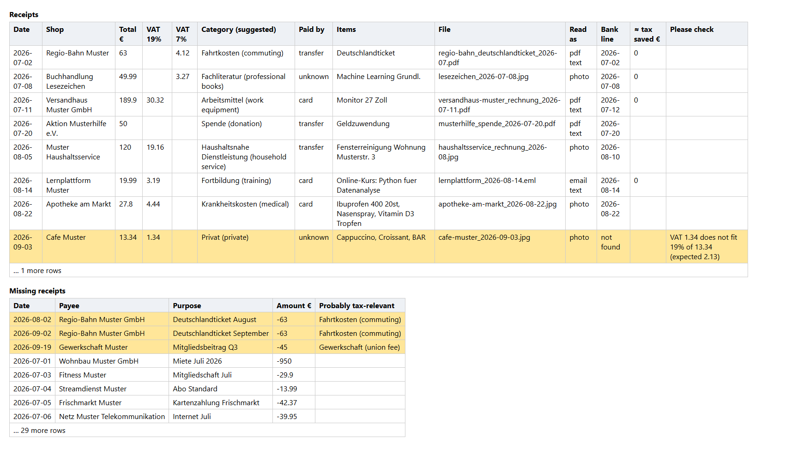
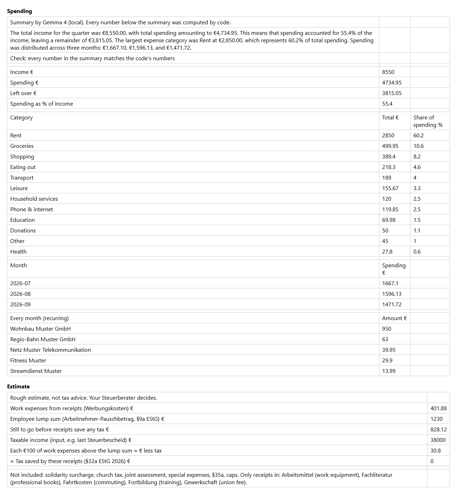

# Belegbuch — your receipts, sorted for the Steuerberater, without leaving your laptop

Every quarter I hand my German tax advisor (Steuerberater) a folder of receipts and a spreadsheet.
Collecting the receipts, typing them in, matching them to the bank statement and finding the ones
that are missing: every one of those steps is tedious. Belegbuch does them on my own computer.

Put photos, PDFs and saved e-mail receipts into one folder, add the CSV export from the bank, and get
an Excel book with four sheets:

| Sheet | What it shows |
|---|---|
| **Receipts** | Every receipt: date, shop, total, VAT 19 % / 7 %, a suggested tax category, which bank line it belongs to, and a yellow row when the code thinks the model misread it |
| **Missing receipts** | Bank payments with no receipt, the probably tax-relevant ones first |
| **Spending** | Where the money went: Gemma 4 labels every bank line (rent, groceries, transport, …) and writes a short summary; code computes every total and share and checks that each number in the summary is one it computed |
| **Estimate** | What the receipts are worth so far: how far you are from the €1,230 Arbeitnehmer-Pauschbetrag and roughly how much tax each €100 above it saves (German tariff 2026) |

It is a sorting helper, not tax advice. The Steuerberater decides.

## Everything runs locally

| Part | Open-source piece | License |
|---|---|---|
| Reading photos and filling the fields | [Gemma 4](https://ai.google.dev/gemma) `gemma4:e4b` on [Ollama](https://github.com/ollama/ollama) | Apache-2.0 / MIT |
| OCR (optional second path) | [PaddleOCR](https://github.com/PaddlePaddle/PaddleOCR) | Apache-2.0 |
| PDF text | [pdfplumber](https://github.com/jsvine/pdfplumber) | MIT |
| Excel | [openpyxl](https://openpyxl.readthedocs.io) | MIT |

Receipts carry names, addresses, card digits and what you bought. In the default setup nothing in the code
calls a remote API: the model runs in Ollama on this machine. (PaddleOCR downloads its model files once,
the first time it runs; receipts are not sent.) A cloud path (Gemma 4 through the Gemini API) exists in the code for people
without the disk space, but it is off by default and sends the receipts to Google.

## How it reads a receipt

1. **Photo** → Gemma 4 reads the image (`RECEIPT_MODE=vision`, default), or PaddleOCR reads the text and Gemma fills the fields (`RECEIPT_MODE=ocr`).
2. **PDF with text** and **saved e-mail (.eml)** → the text goes straight to Gemma; no OCR needed. A scanned PDF is rendered and read like a photo.
3. **The code checks what the model read**: required fields, VAT rate 19 % or 7 %, VAT that fits the total, a known category. Anything odd turns the row yellow.
4. **Bank matching**: a receipt matches a bank payment with the same amount, paid from 3 days before to 14 days
   after the receipt date (invoices are often paid by transfer a few days later).

## Run it

Needs Python 3.11 and [Ollama](https://ollama.com).

```bash
ollama pull gemma4:e4b
python -m venv .venv
.venv/Scripts/python -m pip install -r requirements.txt     # macOS/Linux: .venv/bin/python

# demo with fake data
.venv/Scripts/python scripts/make_demo_receipts.py samples/demo_receipts samples/FAKE_ING_Umsatzanzeige_2026Q3.csv
.venv/Scripts/python src/build_book.py samples/demo_receipts samples/FAKE_ING_Umsatzanzeige_2026Q3.csv Belegbuch.xlsx --zve 38000

# tests
.venv/Scripts/python -m unittest discover -s tests
```

`--zve` is your taxable income (zu versteuerndes Einkommen), e.g. from last year's Steuerbescheid. Without it
the estimate sheet only shows the distance to the Pauschbetrag. Settings live in `.env` (see `.env.example`).
Results are cached in `<folder>/.extracted.json`, so a second run only reads new receipts.

## Demo results (fake data, one run, 2026-10-14)





Nine fake German receipts (five photos, three PDFs, one e-mail; every shop is invented and every receipt is
stamped MUSTER) and a fake ING quarter with 48 bank lines, on a laptop with a Ryzen 5 4600H, 15.4 GB RAM and
integrated graphics only:

- 8 of 9 receipts came back with the right date, shop, total and VAT, and all 9 got the right category.
- The ninth, a café photo, came back with a total of 13.34 instead of 8.40. The VAT check caught it
  (1.34 is not 19 % of 13.34) and marked the row yellow.
- 8 receipts matched their bank line, including a cleaning invoice dated 5 August and paid on 10 August.
  The café was paid in cash, so it has no bank line.
- 37 bank payments had no receipt; 3 were flagged as probably tax-relevant (two train tickets, a union fee).
  The rest are rent, groceries, subscriptions and the like.
- Spending: Gemma 4 sorted the 45 spending lines into 12 categories; I checked the totals by hand
  (e.g. groceries €499.95 = eight supermarket and three organic-shop payments). Its summary used only numbers
  the code had computed; the check found none it had made up.
- 14.2–37.7 s per receipt in this run; the whole build took 4 min 33 s.

These numbers come from receipts I generated, not from real ones; real photos are harder.

## Limits

- The ING CSV layout is written from memory and has not been compared to a real export.
- Tax: only the 2026 tariff (§32a EStG) and the €1,230 Pauschbetrag (§9a EStG). No Solidaritätszuschlag,
  Kirchensteuer, joint assessment, Sonderausgaben, §35a or deduction limits. Categories are suggestions.
- Matching needs exact amounts; split payments or refunds are not handled.
- Donations, household services (§35a) and medical costs are sorted and matched, but not yet valued in the estimate.

## Layout

| Path | What it is |
|---|---|
| `src/extract.py` | Read one receipt with Gemma (photo / PDF / e-mail), code checks |
| `src/bank_ing.py` | Read the ING CSV |
| `src/match.py` | Bank lines ↔ receipts |
| `src/tax.py` | §32a EStG 2026 tariff and the value of extra Werbungskosten |
| `src/build_book.py` | Folder + CSV → Excel |
| `src/spending.py` | Spending labels (Gemma), totals (code), summary (Gemma) and the number check |
| `scripts/make_demo_receipts.py` | Makes the fake demo receipts and bank CSV |
| `samples/` | Fake bank CSV, fake receipts, demo Excel |

## License

MIT — see [LICENSE](LICENSE). Gemma 4 is released by Google under Apache-2.0.
